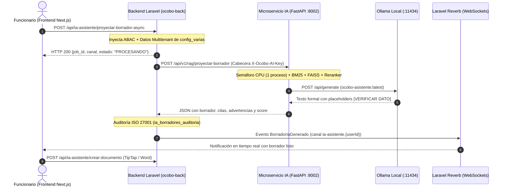

# Guía de Integración Backend — Asistente de IA Local OCOBO

Esta guía documenta la arquitectura, configuración y estándares de integración entre el backend de Laravel (`ocobo-back`) y el microservicio de Inteligencia Artificial local (`Ocobo-IA` en FastAPI `:8002`).

---

## 1. Arquitectura General del Sistema

El Asistente de IA institucional está diseñado bajo una arquitectura de **3 capas desacopladas**, garantizando que el LLM y el motor RAG corran de forma 100% local en CPU/GPU sin enviar datos fuera de la infraestructura de la entidad (cumplimiento estricto de la **Ley 1581 de 2012** y reserva de historia clínica **Ley 23 de 1981**).



### Principios Rectores:
1. **Multitenant Absoluto:** El backend inyecta dinámicamente la razón social, departamento y municipio desde las tablas de configuración (`config_varias` y `config_divi_poli`). Cero nombres institucionales cableados o hardcodeados en el código de IA.
2. **Control de Acceso ABAC Jerárquico:** El backend resuelve la dependencia del usuario consultante (`CalidadOrganigrama`) y filtra los precedentes para que ningún funcionario acceda a radicados o chunks de dependencias no autorizadas.
3. **Resiliencia y Fallback Multinivel:** Si el modelo fine-tuned no está disponible, el sistema conmuta automáticamente al modelo base (`qwen2.5:7b-instruct-q4_K_M`), y si Ollama estuviese caído, genera una plantilla estructurada de contingencia con advertencia preventiva.
4. **Respuestas Semánticas (`ApiResponseTrait`):** Todos los controladores emiten respuestas homogéneas con `{status, success, message, data, errors}`, mapeadas a los toasts semánticos de la interfaz.

---

## 2. Variables de Entorno (`.env` y `config/services.php`)

En el archivo `.env` de `ocobo-back` se configuran los siguientes parámetros:

```ini
# Microservicio de Inteligencia Artificial Local (Ocobo-IA)
IA_SERVICE_URL=http://127.0.0.1:8002
IA_SERVICE_KEY=ocobo_ai_secret_key_2026_local
IA_SERVICE_TIMEOUT=180
IA_SERVICE_ENABLED=true
IA_SERVICE_MODEL=ocobo-asistente:latest
IA_SERVICE_MODEL_FALLBACK=qwen2.5:7b-instruct-q4_K_M
```

Mapeo en `config/services.php`:
```php
'ia' => [
    'url' => env('IA_SERVICE_URL', 'http://127.0.0.1:8002'),
    'key' => env('IA_SERVICE_KEY', 'ocobo_ai_secret_key_2026_local'),
    'timeout' => (int) env('IA_SERVICE_TIMEOUT', 180),
    'enabled' => (bool) env('IA_SERVICE_ENABLED', true),
    'model' => env('IA_SERVICE_MODEL', 'ocobo-asistente:latest'),
    'model_fallback' => env('IA_SERVICE_MODEL_FALLBACK', 'qwen2.5:7b-instruct-q4_K_M'),
],
```

---

## 3. Componentes de Backend (`ocobo-back`)

### 3.1. `IaAsistenteService` (`app/Services/Ia/IaAsistenteService.php`)
Es el servicio principal encargado de orquestar la comunicación con el microservicio:
* **`obtenerEstado()`:** Valida si el servicio está operativo y si la cola de inferencia está disponible.
* **`obtenerDependenciasPermitidas(?User $user)`:** Resuelve el árbol jerárquico del funcionario (`CalidadOrganigrama`) para alimentar el filtro duro ABAC del retriever. Si el usuario tiene el permiso global `Radicar -> Ver Todos`, envía `null` (acceso a todos los precedentes).
* **`obtenerDatosInstitucion()`:** Consulta `config_varias.razon_social_empresa` y resuelve el municipio y departamento vía `config_divi_poli` para parametrizar el encabezado y las firmas institucionales.
* **`buscarPrecedentes(...)`:** Consulta los chunks más relevantes por BM25 + FAISS + Reranker sin ejecutar el LLM (búsqueda rápida para referencia del funcionario).
* **`proyectarBorrador(array $datos, ?User $user)`:** Ejecuta la proyección del borrador oficial enviando la solicitud enriquecida con los metadatos institucionales y el modelo configurado.

### 3.2. Procesamiento Asíncrono (`ProyectarBorradorIaJob` & Reverb)
Dado que la inferencia en CPU de un modelo de 7B toma entre 45 y 90 segundos, la proyección nunca debe bloquear el hilo HTTP de PHP-FPM en producción:
* **Job:** `App\Jobs\Ia\ProyectarBorradorIaJob` se encola en la cola de Laravel (`queue:work`).
* **Evento WebSocket:** Al finalizar la inferencia, emite el evento `App\Events\Ia\BorradorIaGenerado` en el canal privado de Reverb:
  `ia-asistente.{userId}` con el evento `.borrador.generado`.
* **Auditoría ISO 27001:** Cada inferencia se almacena en la tabla `ia_borradores_auditoria` registrando hashes SHA-256, modelo usado, métricas de latencia y tokens, sin almacenar datos sensibles en texto plano.

### 3.3. Integración con el Editor Colaborativo (`IaDocumentoIntegracionService`)
* **Conversión a TipTap / Yjs (`convertirTextoPlanoATipTap`):** Transforma el borrador en párrafos estructurados compatibles con el editor de Mi Bandeja.
* **Marcado Visual Anti-Alucinación:** Detecta automáticamente etiquetas como `[VERIFICAR DATO: ...]` o `[DATO NO DISPONIBLE]` y las envuelve en marcas de resaltado visual (`highlight` amarillo suave) para alertar al funcionario antes de firmar.
* **Fusión con Plantillas Word (`IaDocumentoIntegracionService@generarDocx`):** Descarga el borrador institucional fusionado con las marcas de agua y logos de la entidad usando `PhpWord`.

---

## 4. Endpoints de la API (`routes/ia-asistente.php`)

Todos los endpoints requieren autenticación mediante sesión de Laravel Sanctum (`auth:sanctum`):

| Método | Endpoint | Descripción | Form Request / Parámetros |
|---|---|---|---|
| `GET` | `/api/ia-asistente/status` | Verifica salud del microservicio y memoria RAM | Ninguno |
| `POST` | `/api/ia-asistente/buscar-precedentes` | Búsqueda de precedentes institucionales RAG | `BuscarPrecedentesIaRequest` (`consulta`, `top_k`, `flag_hc`, `flag_tutela`) |
| `POST` | `/api/ia-asistente/proyectar-borrador` | Proyección síncrona directa (espera respuesta) | `ProyectarBorradorIaRequest` |
| `POST` | `/api/ia-asistente/proyectar-borrador-async` | Encola la proyección en segundo plano (Reverb) | `ProyectarBorradorIaRequest` |
| `POST` | `/api/ia-asistente/crear-documento` | Crea un documento colaborativo en Mi Bandeja | `CrearDocumentoDesdeIaRequest` |
| `POST` | `/api/ia-asistente/exportar-docx` | Descarga el borrador en formato Word (.docx) | `asunto`, `borrador`, `plantilla_id` |
| `GET` | `/api/ia-asistente/auditoria` | Consulta el historial de auditoría del usuario | Paginación estándar |

### Ejemplo de Payload de Solicitud (`POST /api/ia-asistente/proyectar-borrador-async`):
```json
{
  "id_radicado": "20261121-00123",
  "asunto": "Solicitud copia historia clínica de familiar fallecido",
  "contenido": "Solicito copia completa de la historia clínica de mi padre fallecido. Para el trámite aporto copia de mi cédula, registro civil de defunción y registro civil de nacimiento.",
  "tipo_solicitud": "Derecho de Petición",
  "flag_hc": true,
  "flag_tutela": false,
  "top_k": 5,
  "anonimizar_automaticamente": true
}
```

### Ejemplo de Respuesta Inmediata del Backend:
```json
{
  "status": true,
  "success": true,
  "message": "Proyección de borrador encolada exitosamente. Recibirá la notificación en tiempo real.",
  "data": {
    "job_id": "7c9e6679-7425-40de-944b-e07fc1f90ae7",
    "canal": "ia-asistente.15",
    "evento": "borrador.generado",
    "estado": "PROCESANDO_EN_SEGUNDO_PLANO"
  }
}
```

---

## 5. Puesta en Marcha en Servidores

Para que la integración funcione de forma continua en el entorno de desarrollo o producción:

### 1. Iniciar el Servidor de Ollama:
```bash
ollama serve
```
*Verificar que el modelo institucional esté disponible:*
```bash
ollama list
# Debe listar: ocobo-asistente:latest (4.7 GB)
```

### 2. Iniciar el Microservicio de IA (FastAPI):
Desde la carpeta `Ocobo-IA` con el entorno virtual activo:
```powershell
cd C:\Users\Jhon\Desktop\Ocobo-IA
.\.venv\Scripts\activate
uvicorn api.main:app --host 127.0.0.1 --port 8002 --workers 1
```

### 3. Iniciar el Worker de Colas de Laravel:
Desde la carpeta `ocobo-back`:
```bash
php artisan queue:work --tries=2 --timeout=200
```

### 4. Iniciar el Servidor WebSocket de Reverb:
```bash
php artisan reverb:start
```

---

## 6. Monitoreo y Verificación de Integración

Puedes validar la conectividad ejecutando la suite de pruebas unitarias del backend:
```bash
php artisan test tests/Unit/IaAsistenteServiceTest.php tests/Unit/IaBorradorAuditoriaTest.php tests/Unit/IaDocumentoIntegracionTest.php
```

Resultado esperado:
```text
   PASS  Tests\Unit\IaAsistenteServiceTest
   PASS  Tests\Unit\IaBorradorAuditoriaTest
   PASS  Tests\Unit\IaDocumentoIntegracionTest

  Tests:    12 passed (61 assertions)
```
